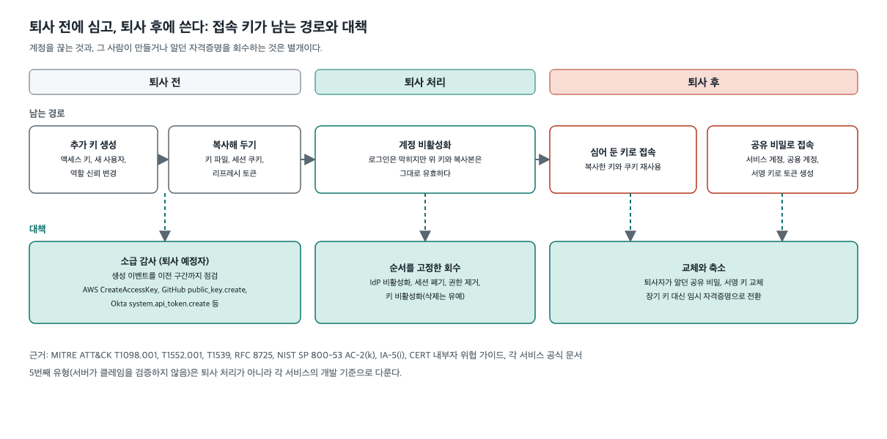
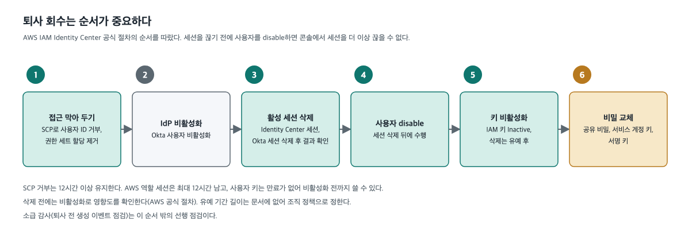

[← 포트폴리오](../README.md) · [무신사](../companies/musinsa.md)

# 퇴사자 접근권한 회수: 계정 차단 이후에 남는 키와 토큰

> 퇴사자의 로그인 계정을 차단해도 그 사람이 만들거나 알던 접속 키와 비밀은 남습니다. 로그인 차단 이후에 남는 접근 경로를 목록으로 관리하고 회수하는 체계를 설계했습니다.

| 조직 | 시기 | 역할 | 상태 |
|---|---|---|---|
| 무신사 | 2026 – | 문제 정의 · 설계 · 프로토타입 | **진행 중** |

---

## 배경

- 통합 로그인(SSO) 계정을 비활성화해도 앱 안의 계정, 클라우드 액세스 키, 개인 토큰 같은 장기 접속 키는 각 서비스에 남습니다.
- 규제는 퇴직 시 접근 권한을 지체 없이 말소하고 처리 기록을 보관하도록 요구합니다. 그러나 퇴사자 접근권한의 잔존 현황이 측정되지 않는 경우가 있고, 그러면 요건 충족 여부를 숫자로 답하기 어렵습니다.
- 서비스에 따라 퇴사 처리 절차가 없을 수 있고, 사용자 정보의 기준이 여러 곳에 흩어져 있을 수 있습니다.

## 제약

- 규제는 수단을 정하지 않습니다. 도구 선택의 근거를 직접 제시해야 했습니다.
- 서비스마다 폐기 규칙이 다릅니다. 공식 문서상 계정을 지우면 키까지 사라지는 서비스도 있고, 비활성화해도 토큰이 계속 동작하는 서비스도 있습니다.
- 퇴사자 명의의 키를 운영 시스템이 쓰고 있을 수 있어, 즉시 삭제하는 방식은 장애로 이어질 수 있습니다.
- 플랜 상향 같은 추가 라이선스 없이 시작해야 했고, 가능한 범위는 이미 쓰는 도구의 계약 조건에 따라 달라집니다.

## 검토와 결정

### 1. 로그인 차단과 자격증명 회수를 분리

사용자 디렉터리가 처리하는 범위는 로그인 계층까지입니다. 앱 안의 계정은 자동 정리(SCIM)를 지원하는 서비스에서만 정리되고, 장기 접속 키는 서비스마다 규칙이 달라 디렉터리로는 해소되지 않았습니다. 그래서 대책을 **목록 → 소유자 정책 → 이벤트 기반 회수** 3단계로 나눴습니다.

### 2. 사용자 디렉터리 도입 여부

- **검토한 대안**: 수동 체크리스트, 다른 로그인 허브 사용, 인사 시스템의 직접 전달.
- **결정**: 사용자 디렉터리를 사용합니다. 규제상 필수는 아니지만 앱별 연동을 한곳으로 모을 수 있어, 확인한 범위에서 연동 수가 가장 적었습니다.
- **감수한 점**: 이미 쓰는 도구의 계약 조건에 따라 추가 비용이 생길 수 있습니다.

**Active Directory는 조건부로 두었습니다.** 처음에는 필요 없다고 정리했습니다. 다시 검토하니 그 결론은 클라우드 앱과 접속 키에만 해당했고, Windows 로그인, VPN, 파일 서버 같은 레거시 시스템이 있는지는 조사하지 않은 상태였습니다. 이런 시스템이 있으면 퇴사 후에도 그 경로로 접근이 남습니다. 그래서 조사 결과에 따라 정하기로 했습니다.

- 의존하는 시스템이 없으면 이 단계를 하지 않습니다.
- 있으면 LDAP 요청을 대신 받는 프록시로 해결되는지 먼저 시험하고, 안 되면 구축합니다. 프록시는 LDAP만 쓰는 앱에 해당하고, Windows 로그인 같은 경로는 별도 확인이 필요합니다.
- 서버 비용은 작을 것으로 가정했습니다(검증 전). 판단 기준은 비용보다 사용자 정보의 원본이 둘이 되는 운영 부담입니다.

### 3. 위협 모델과 설계 변경

퇴사자가 토큰이나 키를 위조·변조해 접근을 유지하는 경우를 공식 자료(MITRE ATT&CK, RFC 8725, OWASP, NIST, 각 서비스 문서)로 정리해 5가지 유형으로 나눴습니다. 여기서 위조는 서명이 가짜라는 뜻이 아니라, 서명 키를 도용해 정상 발급 절차 없이 토큰을 직접 만든다는 뜻입니다. 변조는 서명 키를 쓸 수 있는 경우에 발급된 토큰이나 키의 내용을 바꿔 쓰는 것입니다.

| 유형 | 내용 |
|---|---|
| 서명 키 도용으로 토큰 직접 생성 | 서명 키를 알거나 검증 결함을 악용해 정상 발급 없이 토큰을 만듦 |
| 퇴사 전 추가 자격증명 생성 | 추가 키, 새 계정, 역할 신뢰 변경, 앱 승인 |
| 복사해 둔 키와 세션 재사용 | 자격증명 파일, 세션 쿠키, 리프레시 토큰 |
| 공유 계정 비밀을 앎 | 사람이 떠나도 비밀이 그대로 유지 |
| 서버가 클레임을 검증하지 않음 | 정지된 계정의 토큰이 만료까지 통과 |

처음 계획은 회수와 교체가 중심이었습니다. 그런데 최근 정부 민관합동조사 결과([과기정통부 민관합동조사단 조사결과](https://www.korea.kr/briefing/policyBriefingView.do?newsId=156744092), 2026-02 게재)에 공개된 국내 사례 1건에서 다음 지적이 있었습니다. 퇴사자가 재직 중 확보한 서명 키로 퇴사 후에도 토큰을 직접 만들어 접속했습니다. 서명 키 사본이 키 관리시스템 밖에서 발견되었고, 퇴사 시 서명 키를 교체하는 절차가 없었으며, 서버는 토큰의 정상 발급 여부를 확인하지 않았습니다.

회수와 교체는 유출 이후의 사후 조치라 이런 경로를 모두 막지 못합니다. 그래서 빈틈별 관리 방안을 계획에 넣었습니다. 사례 1건은 발생 빈도의 근거가 아닙니다. (브리핑 속기 전문 기준, 첨부 원본은 확인하지 못함)

- 퇴사자가 같은 서명 키를 계속 보유하는 경우는 키 교체로 다룹니다(설계 단계). 교체 전 피해는 막지 못합니다.
- 서명 키 사본이 키 관리시스템 밖에 있는 경우는 접속 키 목록에 보관 위치, 사본 위치, 접근자를 기록해 다룹니다(설계 단계).
- 서버가 발급 여부를 확인하지 않는 경우는 서비스 개발팀의 점검 항목으로 전달합니다. 이 과제에서 구현하지 않습니다.
- 대량 조회와 비정상 접속 탐지는 사례와 별개로 추가한 연계 항목이며, 보안 모니터링에 요청합니다. 이 과제에서 구현하지 않습니다.

처음 설계는 퇴사자 명의의 키 회수에 한정했습니다. 위협 모델을 그리고 나니 퇴사 전에 만든 추가 키, 저장소에 붙은 키, 알고 있던 공유 비밀이 회수 대상 밖에 있었습니다. 그래서 소급 감사와 공유 비밀 교체를 설계에 추가했습니다(구현 전).

### 4. 회수 순서 고정

공식 절차에 따라 순서를 고정했습니다. 활성 세션을 지우기 전에 사용자를 비활성화하면 세션을 끊지 못하는 경우가 있기 때문입니다.

### 5. 오작동 대비

- 프로토타입의 기본값은 변경 없이 대상만 기록하는 시험 모드입니다.
- 키는 삭제하지 않고 비활성화합니다. 복구할 수 있습니다.
- 바로 끄면 장애가 나는 서비스 계정은 즉시 폐기하지 않고, 후임자 지정과 기한을 두고 처리합니다.
- 한 서비스의 실패가 다른 서비스의 회수를 막지 않고, 실패는 숨기지 않고 재시도되도록 설계했습니다(가짜 객체 시험으로 확인, 실서비스 연결 전).
- 퇴사 처리가 한 도구와 이벤트 알림에 몰리는 점을 단일 장애점으로 기록했습니다. 알림 누락과 도구 장애에 대비한 정기 대조와 수동 절차는 설계 단계입니다(미구현).

### 6. 비용 산정 기준

이미 사용 중인 도구의 이용료는 제외하고, 추가로 드는 금액만 계약 조건별로 나눠 범위로 적었습니다. 사용자 수와 환율은 가정값으로 표시했습니다.

---

## 현재 상태

| 구분 | 내용 |
|---|---|
| 완료 | 문제 정의, 설계, 프로토타입(클라우드 액세스 키, 소스 저장소 SSO 승인, 이슈 트래커 API 토큰 회수), 인벤토리 화면 목업 |
| 시험 | 가짜 객체로 15건. 실서비스에는 연결하지 않음 |
| 설계 단계 | 세션 폐기, 저장소에 붙은 키 회수, 공유 비밀 교체, 소급 감사, 서명 키 교체, 서명 키 보관 위치 기록 |
| 조사 전 | 레거시 시스템 유무. 결과로 Active Directory 단계의 진행 여부를 결정 |

## 검증 방법

- 공식 문서로 확인한 사실에는 출처를 달았습니다. 확인하지 못한 것(비활성화가 세션까지 지우는지, 조직 탈퇴 후 개인 토큰의 접근 잔존 여부)은 미확인으로 남겼습니다. 원문을 열지 못한 표준은 2차 자료 기준임을 밝혔습니다.
- 비판적 검토와 처음 보는 사람의 관점 점검에서 세 가지를 정정했습니다.
- 정정 1: "예산 없이 시작한다"를 계약 확인을 전제로 한 표현으로 한정했습니다.
- 정정 2: 근거 없이 단정한 빈도 표현을 삭제했습니다.
- 정정 3: "Active Directory는 불필요"를 "조사 후 결정"으로 바꿨습니다.

## 회고 (중간)

- **회수의 어려움은 소유자를 아는 것입니다.** 가짜 객체 시험 범위에서는 키를 끄는 동작 자체는 어렵지 않았습니다(실서비스 검증 전). 소유자가 기록되지 않은 키는 퇴사 이벤트가 와도 회수되지 않으므로, 목록과 소유자 정책을 자동 회수보다 먼저 두었습니다.
- **초안에서 비용과 구현 범위를 낙관적으로 적었고 검토에서 정정했습니다.** 이후에는 가정값과 시험 전 항목을 문장 안에 표시합니다.
- **위협 모델을 설계보다 먼저 그렸어야 했습니다.** 퇴사자 명의의 키만 보다가 목록 밖의 키를 뒤늦게 발견했습니다.

---

**관련 케이스**: [클라우드 보안 프레임워크](07-cloud-security-framework.md)(Okta 기반 인증체계) · [전사 장애관리 프레임워크](01-incident-management-framework.md) · [신뢰성 자동화](04-reliability-automation.md) · [AI 거버넌스 프레임워크](05-ai-governance.md)

`계정 수명주기` `JML` `접근권한 회수` `위협 모델링` `MITRE ATT&CK` `Okta` `Active Directory` `AWS IAM` `SCIM` `비밀 교체` `ISMS-P`
